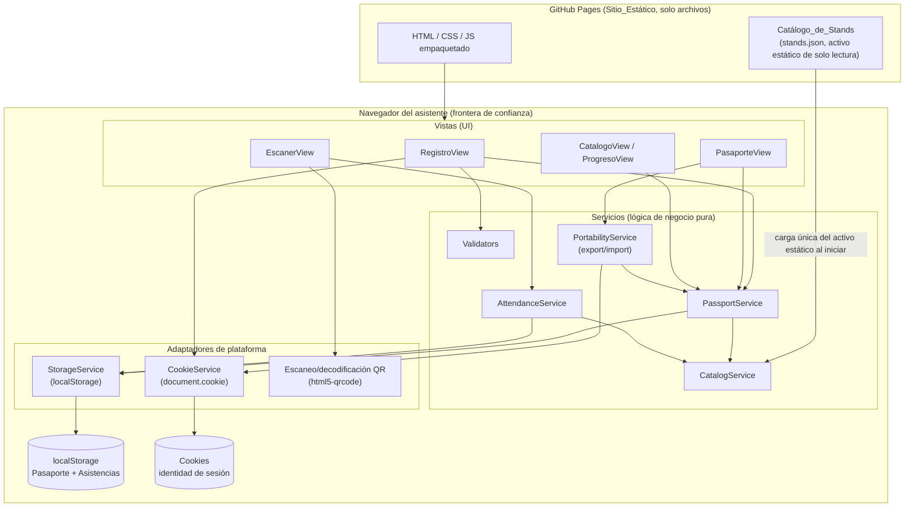
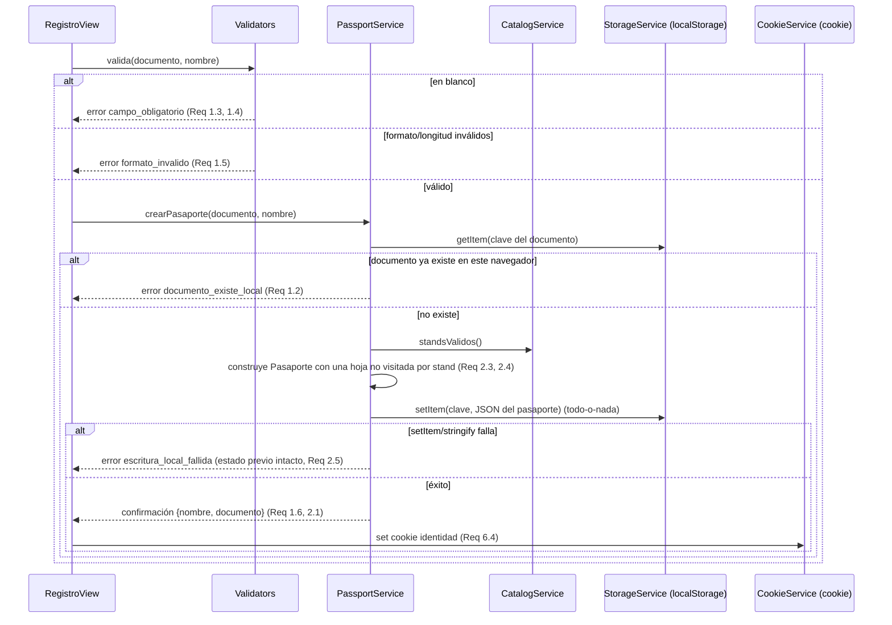
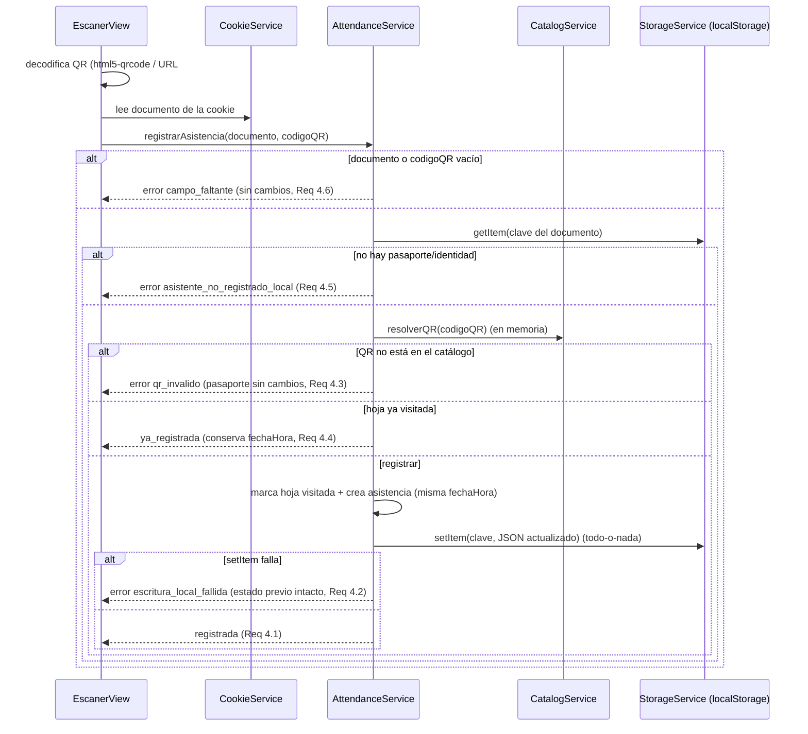
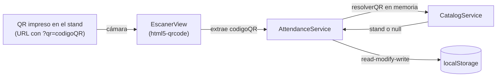

# Documento de Diseño

## Overview

Este documento describe el diseño técnico del sistema de **toma de asistencia por pasaportes digitales** para el hackatón de AWS. Los asistentes se registran con su número de documento y nombre, reciben un pasaporte digital con una hoja por cada stand del evento y registran su asistencia escaneando el código QR único de cada stand. La aplicación también permite consultar el progreso del pasaporte y exportar/importar el pasaporte entre dispositivos.

El principio arquitectónico central nace del **Requirement 6**: la plataforma es un **sitio 100% estático** alojado en **GitHub Pages**, **sin servidor backend, sin funciones serverless y sin base de datos administrada**. Toda la lógica de negocio se ejecuta **en el navegador del asistente** (TypeScript compilado y empaquetado dentro del sitio estático). No existe ningún servicio remoto al que la aplicación llame para operar, por lo que **no hay credenciales, secretos, autenticación remota ni preocupaciones de CORS**.

### Modelo de datos y frontera de confianza

- **Pasaporte y asistencias** (stands visitados y marcas de tiempo) se guardan en el **Almacenamiento_Local** (`localStorage`) del navegador, en el dispositivo del asistente (Req 6.3).
- **La identidad o sesión** (nombre y número de documento) se guarda en **Cookies** del navegador (Req 6.4).
- **Los stands y sus códigos QR** se publican como un **Catálogo_de_Stands estático de solo lectura** (un archivo JSON versionado) incluido en el sitio estático (Req 6.5). El organizador lo edita confirmando cambios en el repositorio de GitHub; en tiempo de ejecución es inmutable.

El **dispositivo/navegador del asistente es la frontera de confianza**. La validación de formato, unicidad y consistencia de escritura se ejecuta localmente sobre los datos del propio navegador. La integridad del catálogo se garantiza por el flujo de revisión de commits del repositorio, no en tiempo de ejecución.

### Tradeoffs aceptados

1. **No existe un registro central de asistencias** (Req 6.6). El pasaporte de cada asistente existe **únicamente en su propio dispositivo**; el organizador no obtiene una vista centralizada de quién visitó cada stand. Es una limitación aceptada a cambio de una arquitectura sin servidor ni base de datos.
2. **Pérdida de datos al limpiar el navegador** (Req 7.1). Si el asistente borra `localStorage` y las cookies, el pasaporte y la sesión desaparecen, porque no existían en ningún otro lugar. Para mitigarlo, el sistema ofrece **exportar/importar** el pasaporte como un JSON portable (Req 7.2–7.4).
3. **La unicidad y la consistencia son por-dispositivo**, no globales. "Exactamente un pasaporte por asistente" (Req 2.2) se entiende como "por documento dentro de ese navegador". No se intenta deduplicar entre dispositivos porque no hay fuente de verdad central.

### Decisiones de diseño clave

1. **Lógica de negocio pura y aislada del almacenamiento.** Los servicios (`PassportService`, `AttendanceService`, `CatalogService`, `Validators`, `PortabilityService`) se diseñan como funciones deterministas sobre estructuras de datos, con el acceso a `localStorage` detrás de una interfaz `StorageService` y las cookies detrás de `CookieService`. Esto permite probar la lógica con dobles en memoria y hace que las propiedades sean verificables con pruebas basadas en propiedades.
2. **Escritura todo-o-nada a nivel de blob JSON.** Como no existe un motor transaccional, la consistencia se logra serializando el pasaporte completo a **una sola clave** de `localStorage`; la escritura es atómica al nivel del blob (ver *Consistencia de escritura local*).
3. **El catálogo es de solo lectura.** La aplicación nunca escribe el catálogo; solo lo lee para reconciliar las hojas del pasaporte local.

## Architecture

### Visión general (solo navegador, sin red)

Toda la aplicación corre dentro del navegador. El único "origen externo" es el propio sitio estático de GitHub Pages, del cual el navegador descarga el bundle JS/CSS/HTML y el activo estático `stands.json`. En tiempo de ejecución no hay llamadas de red a APIs de negocio.



### Responsabilidades de los módulos

- **Vistas (UI):**
  - **RegistroView**: formulario de documento + nombre; valida con `Validators`, crea el pasaporte con `PassportService` y guarda la identidad en la cookie con `CookieService` (Req 1, 2, 6.4).
  - **PasaporteView**: muestra las hojas y el estado de cada stand leído de `PassportService`; ofrece exportar/importar mediante `PortabilityService` (Req 2.6–2.8, 5, 7).
  - **EscanerView**: activa la cámara, decodifica el QR con `html5-qrcode` (o extrae el parámetro `qr` de una URL profunda) y delega en `AttendanceService` (Req 4).
  - **CatalogoView / ProgresoView**: muestra el conteo de progreso (visitados/total) y la lista de stands del pasaporte reconciliado (Req 5).
- **Servicios (lógica de negocio pura):**
  - **CatalogService**: carga el `Catálogo_de_Stands` desde el activo estático (una sola vez al iniciar), filtra entradas inválidas y lo mantiene **en memoria, de solo lectura** (Req 3.1–3.5).
  - **PassportService**: crea, consulta y reconcilia pasaportes contra el catálogo; calcula el progreso (Req 1, 2, 3.6, 3.7, 5).
  - **AttendanceService**: resuelve un QR contra el catálogo en memoria y registra la asistencia marcando la hoja, de forma idempotente (Req 4).
  - **Validators**: validación de formato de documento y nombre, de entradas del catálogo y de entradas de importación (Req 1.1, 1.3–1.5, 3.4, 3.5, 4.6, 7.4).
  - **PortabilityService**: exporta el pasaporte local a JSON portable e importa un JSON portable validándolo (Req 7.2–7.4).
- **Adaptadores de plataforma:**
  - **StorageService**: interfaz fina sobre `localStorage` (`getItem`/`setItem`/`removeItem`), reemplazable por un doble en memoria para pruebas.
  - **CookieService**: lee/escribe la cookie de identidad (`document.cookie`).
  - **Escaneo/decodificación QR**: `html5-qrcode` para la cámara. El renderizado de imágenes QR **no es necesario en tiempo de ejecución** porque los QR ya vienen pre-generados en el catálogo.

### Flujo de registro (Req 1 y 2, totalmente en el navegador)



### Flujo de escaneo de QR (Req 4, sin llamadas de red)



## Components and Interfaces

Todas las interfaces son **módulos TypeScript del lado cliente**; no existe ninguna API REST. Los servicios reciben `StorageService`, `CookieService` y `CatalogService` por inyección para poder sustituirlos por dobles en pruebas.

### Tipos de resultado

```typescript
// Resultado uniforme: evita excepciones para errores de dominio esperados.
type Resultado<T> =
  | { ok: true; valor: T }
  | { ok: false; error: CodigoError; mensaje: string };

type CodigoError =
  | "campo_obligatorio"
  | "formato_invalido"
  | "documento_existe_local"
  | "pasaporte_no_existe_local"
  | "asistente_no_registrado_local"
  | "qr_invalido"
  | "ya_registrada"
  | "campo_faltante"
  | "escritura_local_fallida"
  | "importacion_invalida";
```

### StorageService (adaptador de localStorage)

```typescript
interface StorageService {
  getItem(clave: string): string | null;
  setItem(clave: string, valor: string): void; // puede lanzar (p. ej. QuotaExceededError)
  removeItem(clave: string): void;
  claves(): string[]; // enumera claves (para contar pasaportes del navegador)
}
```

### CookieService (adaptador de cookies)

```typescript
interface CookieService {
  setIdentidad(identidad: { documento: string; nombre: string }): void; // Req 6.4, 1.6
  getIdentidad(): { documento: string; nombre: string } | null;         // Req 4.5
  limpiarIdentidad(): void;                                             // Req 7.1
}
```

### CatalogService (catálogo estático de solo lectura)

```typescript
interface CatalogService {
  // Carga una sola vez el activo estático stands.json y filtra entradas inválidas (Req 3.1, 3.5).
  cargar(url?: string): Promise<void>;
  // Lista inmutable (congelada) de stands válidos (Req 3.1, 3.2, 3.4).
  standsValidos(): ReadonlyArray<Stand>;
  // Resuelve un código QR a su stand, o null si no existe (Req 4.3).
  resolverQR(codigoQR: string): Stand | null;
}
```

El catálogo cargado se congela (`Object.freeze`) para garantizar que es de solo lectura en tiempo de ejecución (Req 3.2): no existe ningún método de escritura.

### Validators (funciones puras)

```typescript
function validarDocumento(documento: string | null | undefined): Resultado<string>; // solo dígitos, 5–20 (Req 1.1, 1.3, 1.5)
function validarNombre(nombre: string | null | undefined): Resultado<string>;        // 1–100, no solo espacios (Req 1.1, 1.4, 1.5)
function esStandValido(entrada: unknown): entrada is Stand;                           // nombre trim 1–100 + codigoQR (Req 3.4, 3.5)
function validarPortable(entrada: unknown): Resultado<PortablePassport>;              // forma de importación (Req 7.4)
```

### PassportService

```typescript
interface PassportService {
  // Req 1.1, 1.2, 1.6, 2.1–2.5
  crearPasaporte(documento: string, nombre: string): Resultado<{ documento: string; nombre: string }>;
  // Req 2.6–2.8, 5.1–5.4: reconcilia con el catálogo (Req 3.6, 3.7) antes de devolver.
  consultarProgreso(documento: string): Resultado<ProgresoPasaporte>;
  // Transformación pura de reconciliación (Req 3.6, 3.7). Expuesta para pruebas.
  reconciliar(pasaporte: Pasaporte, catalogo: ReadonlyArray<Stand>): Pasaporte;
}
```

### AttendanceService

```typescript
interface AttendanceService {
  // Req 4.1–4.6: resuelve el QR contra el catálogo y escribe en localStorage de forma todo-o-nada.
  registrarAsistencia(documento: string, codigoQR: string): Resultado<RegistroAsistencia>;
}

interface RegistroAsistencia {
  estado: "registrada" | "ya_registrada";
  standNombre: string;
  fechaHora: string;
}
```

### PortabilityService (exportar / importar)

```typescript
interface PortabilityService {
  // Req 7.2: produce el JSON portable del pasaporte local.
  exportar(documento: string): Resultado<PortablePassport>;
  // Req 7.3, 7.4: valida, crea/reemplaza el pasaporte local y restaura la cookie de identidad.
  importar(entrada: unknown): Resultado<{ documento: string; nombre: string }>;
}
```

### Vistas (interfaces de UI)

```typescript
interface RegistroView {   // Req 1, 2, 6.4
  enviar(documento: string, nombre: string): void;
}
interface PasaporteView {  // Req 2.6–2.8, 5, 7
  mostrar(documento: string): void;
  exportar(): void;
  importar(archivo: File): void;
}
interface EscanerView {    // Req 4
  iniciarCamara(): void;
  procesarQR(codigoQR: string): void;
}
interface CatalogoView {   // Req 5 (ProgresoView)
  mostrarProgreso(documento: string): void;
}
```

## Data Models

Todos los modelos son estructuras serializables a JSON. El pasaporte de un asistente se guarda **completo en una sola clave** de `localStorage`.

```typescript
// Entrada del Catálogo_de_Stands (activo estático de solo lectura).
interface Stand {
  standId: string;     // identificador estable dentro del catálogo
  nombre: string;      // 1–100 caracteres tras recortar espacios (Req 3.4)
  codigoQR: string;    // único dentro del catálogo (Req 3.4)
}

// Hoja del pasaporte correspondiente a un stand.
interface HojaPasaporte {
  standId: string;
  standNombre: string;
  visitado: boolean;
  fechaHora?: string;  // presente si y solo si visitado === true (ISO 8601)
}

// Registro de asistencia a un stand (embebido en el pasaporte).
interface Asistencia {
  standId: string;
  fechaHora: string;   // ISO 8601
}

// Pasaporte persistido en localStorage (un blob por documento).
interface Pasaporte {
  documento: string;
  nombre?: string;
  hojas: HojaPasaporte[];
  asistencias: Asistencia[];
}

// Progreso derivado para la UI (Req 5).
interface ProgresoPasaporte {
  documento: string;
  nombre?: string;
  visitados: number;   // 0 <= visitados <= total (Req 5.1)
  total: number;
  hojas: HojaPasaporte[];
}

// Representación portable para exportar/importar (Req 7).
interface PortablePassport {
  version: 1;
  documento: string;
  nombre: string;
  hojas: Array<{
    standId: string;
    standNombre: string;
    visitado: boolean;
    fechaHora?: string;
  }>;
}
```

### Forma del Catálogo_de_Stands estático (`stands.json`)

```json
{
  "version": 1,
  "stands": [
    { "standId": "epm", "nombre": "EPM", "codigoQR": "a3f9c1e8-..." },
    { "standId": "isa", "nombre": "ISA", "codigoQR": "b7d2e4a0-..." }
  ]
}
```

Es un activo estático de solo lectura incluido en el build del sitio (Req 3.1, 6.5). El organizador lo edita confirmando cambios en el repositorio de GitHub.

### Esquema de claves de localStorage

- **Un pasaporte por clave**, indexado por documento:
  - Clave: `pasaporte:{documento}` → valor: `JSON.stringify(Pasaporte)`.
- El valor es **un único blob JSON**; no se reparte el pasaporte en varias claves. Esto es deliberado para la *consistencia de escritura local* (una sola `setItem` es la unidad atómica).
- La existencia de la clave `pasaporte:{documento}` equivale a "existe exactamente un pasaporte para ese documento en este navegador" (Req 2.2): no puede haber dos valores para la misma clave.

### Identidad en cookie

- Cookie `epa_identidad` → `JSON.stringify({ documento, nombre })`. Es identidad de conveniencia para la sesión (Req 6.4); la fuente de verdad del pasaporte es `localStorage`.

### Invariantes de datos

- Una sola clave por documento ⇒ a lo sumo un pasaporte por asistente por navegador (Req 2.2).
- En toda `HojaPasaporte`: `visitado === true` ⟺ `fechaHora` definido (Req 5.2, 5.3).
- `visitados = |{ h ∈ hojas : h.visitado }|` y `total = |hojas|`, con `0 <= visitados <= total` (Req 5.1).
- El catálogo en memoria nunca se muta en tiempo de ejecución (Req 3.2).

### Normalización

- `documento`: se recorta y se valida como solo dígitos de longitud 5–20.
- `nombre` (asistente y stand): se recorta (trim) antes de validar longitud (1–100).

## Flujo de Códigos QR

Esta sección detalla el ciclo de vida del `Código_QR` en el modelo estático (Req 3.1–3.5, 4.1–4.6).

### Origen de los códigos QR

1. **Pre-definidos en el catálogo (Req 3.3).** Los códigos QR **no** se generan en tiempo de ejecución. El organizador los declara en el `Catálogo_de_Stands` (`stands.json`) al publicar, confirmando los cambios en el repositorio de GitHub. Cada stand del catálogo declara su `codigoQR`.
2. **Forma del código.** El `codigoQR` es un **token opaco** (por ejemplo, una cadena aleatoria de alta entropía o UUID) embebido como una **URL profunda** hacia el propio sitio estático:
   `https://<usuario>.github.io/<proyecto>/#/scan?qr=<codigoQR>`
   Codificar una URL permite que, al escanear con la cámara nativa del teléfono, el asistente sea llevado directamente a la vista de escaneo del sitio estático.
3. **Unicidad garantizada en autoría (Req 3.4, 3.5).** La unicidad del `codigoQR` se garantiza **al momento de editar el catálogo**, no en tiempo de ejecución. Al cargar, `CatalogService` descarta entradas inválidas: nombre vacío o mayor a 100 caracteres tras recortar, o `codigoQR` duplicado respecto de otra entrada del catálogo (se ignoran los duplicados). El sistema continúa operando con las entradas válidas restantes.

### Escaneo y resolución (sin red)



1. **Captura.** `EscanerView` decodifica el QR con `html5-qrcode`; si se llegó por URL profunda, extrae directamente el parámetro `qr`.
2. **Identidad.** El `documento` se toma de la cookie (Req 6.4); si no existe identidad ni pasaporte, el escaneo se rechaza como `asistente_no_registrado_local` (Req 4.5).
3. **Resolución en memoria.** `AttendanceService` resuelve `codigoQR` → `stand` contra el catálogo cargado en memoria. Si no hay coincidencia, responde `qr_invalido` sin modificar el pasaporte (Req 4.3).
4. **Escritura local.** Si la hoja aún no está visitada, se marca como visitada y se añade la `Asistencia` con la misma `fechaHora`, persistiendo el pasaporte completo en su clave de `localStorage` (Req 4.1).
5. **Idempotencia (Req 4.4).** Si la hoja ya estaba visitada, no se modifica nada y se devuelve `ya_registrada`, conservando la `fechaHora` original. La idempotencia se logra comprobando el estado de la hoja local antes de escribir.

## Consistencia de escritura local

Este modelo es el **análogo cliente de la atomicidad transaccional**. En el navegador no hay motor transaccional, por lo que la consistencia se logra con una estrategia **read-modify-write sobre un único blob JSON**:

1. El pasaporte completo (perfil, hojas y asistencias) se serializa a **una sola clave** `pasaporte:{documento}`.
2. Una operación de cambio sigue el patrón **leer → modificar en memoria → escribir**:
   - Leer el blob actual con `getItem` y parsearlo.
   - Construir una **copia nueva** del pasaporte con los cambios aplicados (sin mutar el objeto original en memoria).
   - Serializar la copia con `JSON.stringify` y escribirla con una **única** llamada `setItem`.
3. **Todo-o-nada a nivel de blob.** Como la escritura es una sola `setItem`, o se aplica el nuevo estado completo o no se aplica ninguno: no pueden quedar "medias hojas" o una asistencia sin su marca de hoja.
4. **Preservación ante fallo.** Si `JSON.stringify` o `setItem` lanzan (por ejemplo `QuotaExceededError`), el servicio captura la excepción, **no** vuelve a escribir y devuelve `escritura_local_fallida`. Como el objeto en memoria era una copia, el valor previamente almacenado en `localStorage` permanece intacto.

Así se satisfacen los Req 2.5 ("el registro no deja un pasaporte parcial") y Req 4.2 ("el pasaporte queda en su estado previo al escaneo") **sin un servidor**: la unidad atómica es el blob JSON del pasaporte y el punto de confirmación es la única llamada `setItem`.

## Catálogo y reconciliación de hojas

Como el catálogo es estático y puede cambiar entre visitas del asistente (el organizador edita `stands.json`), el pasaporte local se **reconcilia** contra el catálogo al consultarlo o antes de un escaneo (Req 3.5, 3.6, 3.7):

- **Entradas inválidas del catálogo se ignoran (Req 3.5).** `CatalogService.standsValidos()` ya excluye entradas con nombre vacío, nombre >100 tras recortar o `codigoQR` duplicado. La reconciliación opera únicamente sobre stands válidos.
- **Stand en el catálogo sin hoja local (Req 3.6).** Se agrega al pasaporte una `HojaPasaporte` nueva para ese stand en estado **no visitado**. (Esto también cubre el caso de registro con catálogo vacío que luego gana stands.)
- **Hoja local de un stand ausente del catálogo (Req 3.7).** Se **conserva sin cambios** su estado de visita y su `fechaHora`. No se elimina ni se altera, de modo que el asistente no pierde una visita ya registrada aunque el organizador retire el stand.

La reconciliación es una transformación pura `reconciliar(pasaporte, catálogo) → pasaporte'` cuyo resultado, si cambia, se persiste con la misma estrategia todo-o-nada descrita arriba.

## Exportación / Importación (Requirement 7)

### Exportar (Req 7.2)

`PortabilityService.exportar(documento)` lee el pasaporte local y produce un `PortablePassport` que incluye `documento`, `nombre` y las hojas con su estado de visita y las fechas y horas de escaneo. El resultado es un JSON descargable por el asistente. Esquema portable:

```json
{
  "version": 1,
  "documento": "12345678",
  "nombre": "Ada Lovelace",
  "hojas": [
    { "standId": "epm", "standNombre": "EPM", "visitado": true, "fechaHora": "2026-10-12T15:04:05.000Z" },
    { "standId": "isa", "standNombre": "ISA", "visitado": false }
  ]
}
```

### Importar (Req 7.3, 7.4)

`PortabilityService.importar(entrada)`:

1. **Valida** la entrada con `validarPortable`: debe tener `version` soportada, `documento` válido (solo dígitos 5–20), `nombre` válido (1–100 no en blanco) y `hojas` bien formadas (cada hoja con `visitado: boolean` y, si `visitado`, `fechaHora` presente). Si algo falla, devuelve `importacion_invalida` **sin tocar** `localStorage` (Req 7.4).
2. **Crea o reemplaza** el pasaporte local bajo la clave `pasaporte:{documento}` con el contenido importado (semántica de reemplazo). Las asistencias se derivan de las hojas visitadas.
3. **Restaura la identidad** escribiendo la cookie `epa_identidad` con `{ documento, nombre }` (Req 7.3).

El ciclo exportar→importar es un **round-trip**: importar lo exportado en un navegador limpio reconstruye un pasaporte equivalente (misma identidad y mismas hojas con su estado y fechas).

## Error Handling

Todos los errores son **de dominio y del lado cliente**; se modelan como `Resultado<T>` con `ok: false` (no se usan excepciones para flujos esperados). La UI muestra el mensaje asociado al `CodigoError`.

| Situación | Código de error | Mensaje (ejemplo) | Requisito |
|---|---|---|---|
| Documento o nombre vacío / solo espacios en registro | `campo_obligatorio` | "El número de documento es obligatorio" / "El nombre es obligatorio" | 1.3, 1.4 |
| Documento con no-dígitos o longitud fuera de 5–20, o nombre >100 | `formato_invalido` | "Formato o longitud inválidos en el campo indicado" | 1.5 |
| Documento ya registrado en este navegador | `documento_existe_local` | "El número de documento ya existe en este dispositivo" | 1.2 |
| Consulta de pasaporte inexistente en este navegador | `pasaporte_no_existe_local` | "El pasaporte no existe en este dispositivo" | 2.8 |
| Escaneo con QR fuera del catálogo | `qr_invalido` | "El código QR no es válido" | 4.3 |
| Re-escaneo de un stand ya visitado | `ya_registrada` | "La asistencia a ese stand ya fue registrada" | 4.4 |
| Escaneo/consulta sin identidad de asistente registrada | `asistente_no_registrado_local` | "El asistente no está registrado en este dispositivo" | 4.5, 5.4 |
| Escaneo con documento o codigoQR vacío | `campo_faltante` | "Falta el campo indicado" | 4.6 |
| Fallo de `setItem`/`stringify` (p. ej. cuota) en registro o escaneo | `escritura_local_fallida` | "No se pudo completar la operación; se conservó el estado previo" | 2.5, 4.2 |
| Importación con formato inválido o incompleto | `importacion_invalida` | "Los datos de importación no son válidos" | 7.4 |

En los casos `escritura_local_fallida`, `qr_invalido`, `asistente_no_registrado_local`, `campo_faltante`, `campo_obligatorio`, `formato_invalido`, `documento_existe_local` e `importacion_invalida`, **el `localStorage` permanece sin cambios** (no se produce escritura o se preserva el valor previo).

## Correctness Properties

*Una propiedad es una característica o comportamiento que debe cumplirse en todas las ejecuciones válidas de un sistema; en esencia, una afirmación formal sobre lo que el sistema debe hacer. Las propiedades son el puente entre las especificaciones legibles por humanos y las garantías de corrección verificables por máquina.*

Estas propiedades se derivan del prework y se consolidan para evitar redundancia. Se eliminaron las propiedades del modelo servidor anterior (atomicidad transaccional de DynamoDB, propagación de creación de stands, generación de unicidad de `codigoQR` en tiempo de ejecución y unicidad global de nombre), ya que los stands provienen ahora de un catálogo estático de solo lectura y no existe un servidor.

### Property 1: Registro válido crea la cuenta

*Para cualquier* número de documento válido (solo dígitos, longitud 5–20) y nombre válido (1–100 caracteres con al menos un carácter distinto de espacio), `crearPasaporte` debe persistir una cuenta/pasaporte en el Almacenamiento_Local asociada a ese documento y nombre, y devolver una confirmación que incluya el nombre y el número de documento.

**Validates: Requirements 1.1, 1.6**

### Property 2: Campos obligatorios en blanco rechazados

*Para cualquier* valor de documento o de nombre ausente, vacío o compuesto únicamente por espacios en blanco, el registro debe rechazarse con `campo_obligatorio` y el Almacenamiento_Local debe quedar sin cambios.

**Validates: Requirements 1.3, 1.4**

### Property 3: Formato o longitud inválidos rechazados

*Para cualquier* documento que contenga caracteres distintos de dígitos o cuya longitud esté fuera del rango 5–20, o cualquier nombre cuya longitud exceda 100 caracteres, el registro debe rechazarse con `formato_invalido` y el Almacenamiento_Local debe quedar sin cambios.

**Validates: Requirements 1.5**

### Property 4: Unicidad de documento por dispositivo

*Para cualquier* documento ya registrado en el navegador, un segundo registro con el mismo documento debe rechazarse con `documento_existe_local`, de modo que exista **exactamente un** pasaporte por documento en ese navegador (ni cero ni más de uno).

**Validates: Requirements 1.2, 2.1, 2.2**

### Property 5: Pasaporte nuevo con una hoja no visitada por stand del catálogo

*Para cualquier* catálogo de stands válidos de tamaño N (incluyendo N = 0), un pasaporte recién creado debe contener exactamente N hojas, una por cada stand del catálogo, todas en estado no visitado y sin fecha ni hora de escaneo; si el catálogo está vacío, la lista de hojas debe estar vacía.

**Validates: Requirements 2.3, 2.4**

### Property 6: Consistencia de escritura local en registro

*Para cualquier* estado previo del Almacenamiento_Local, si la escritura del pasaporte falla durante el registro (p. ej. `setItem`/`stringify` lanza), el sistema debe devolver `escritura_local_fallida`, no debe quedar ningún pasaporte parcial y el valor previamente almacenado debe conservarse intacto.

**Validates: Requirements 2.5**

### Property 7: La consulta refleja fielmente el estado (fecha si y solo si visitado)

*Para cualquier* pasaporte almacenado, consultarlo debe devolver el número de documento, el nombre (cuando esté disponible) y, por cada hoja, el nombre del stand y su estado de visita, con la fecha y hora presentes **si y solo si** la hoja está marcada como visitada.

**Validates: Requirements 2.6, 2.7, 5.2, 5.3**

### Property 8: Consulta de documento no registrado localmente es rechazada

*Para cualquier* documento que no corresponda a un pasaporte existente en el Almacenamiento_Local, la consulta debe rechazarse con `pasaporte_no_existe_local` / `asistente_no_registrado_local`.

**Validates: Requirements 2.8, 5.4**

### Property 9: Conteo de progreso consistente

*Para cualquier* pasaporte, `consultarProgreso` debe devolver `visitados` igual al número de hojas visitadas y `total` igual al número total de hojas, cumpliendo `0 <= visitados <= total`.

**Validates: Requirements 5.1**

### Property 10: Reconciliación agrega hoja no visitada por stand nuevo del catálogo

*Para cualquier* pasaporte y catálogo, tras reconciliar, cada stand del catálogo que no tuviera una hoja previa en el pasaporte debe quedar representado por una nueva hoja en estado no visitado.

**Validates: Requirements 3.6**

### Property 11: Reconciliación conserva hojas de stands removidos del catálogo

*Para cualquier* pasaporte que contenga hojas de stands ausentes del catálogo, la reconciliación debe conservar esas hojas sin modificar su estado de visita ni su fecha y hora de escaneo.

**Validates: Requirements 3.7**

### Property 12: Entradas inválidas del catálogo son ignoradas

*Para cualquier* catálogo que mezcle entradas válidas e inválidas (nombre vacío, nombre >100 tras recortar, o `codigoQR` duplicado), `standsValidos()` debe devolver únicamente las entradas válidas, sin `codigoQR` duplicados.

**Validates: Requirements 3.5**

### Property 13: Escaneo marca la hoja y registra la asistencia juntos

*Para cualquier* pasaporte con una hoja no visitada cuyo stand está en el catálogo, escanear su `codigoQR` debe marcar esa hoja como visitada y añadir una asistencia con la misma fecha y hora, quedando ambos cambios guardados juntos en el Almacenamiento_Local.

**Validates: Requirements 4.1**

### Property 14: Consistencia de escritura local en escaneo

*Para cualquier* estado previo del pasaporte, si la escritura falla durante el escaneo (p. ej. `setItem` lanza), el sistema debe devolver `escritura_local_fallida` y el pasaporte almacenado debe permanecer idéntico a su estado previo al escaneo.

**Validates: Requirements 4.2**

### Property 15: QR inexistente no modifica el pasaporte

*Para cualquier* `codigoQR` que no corresponda a ningún stand del catálogo, el escaneo debe devolver `qr_invalido` y el pasaporte local debe permanecer sin cambios.

**Validates: Requirements 4.3**

### Property 16: Re-escaneo idempotente conserva la fecha y hora original

*Para cualquier* hoja ya visitada, escanear nuevamente su `codigoQR` debe devolver `ya_registrada` y conservar sin cambios el registro de asistencia original, incluyendo su fecha y hora (idempotencia: la segunda operación no altera el estado).

**Validates: Requirements 4.4**

### Property 17: Escaneo sin identidad registrada es rechazado

*Para cualquier* escaneo realizado con un documento que no corresponde a un pasaporte/identidad registrada en el navegador, el sistema debe rechazarlo con `asistente_no_registrado_local` sin modificar el Almacenamiento_Local.

**Validates: Requirements 4.5**

### Property 18: Escaneo con campos vacíos rechazado sin efectos

*Para cualquier* escaneo enviado con el documento vacío o el `codigoQR` vacío, el sistema debe rechazarlo con `campo_faltante` y no debe modificar ningún pasaporte local.

**Validates: Requirements 4.6**

### Property 19: Exportar/Importar round-trip preserva el pasaporte

*Para cualquier* pasaporte válido, exportarlo y luego importar el resultado en un navegador limpio debe reconstruir un pasaporte equivalente (misma identidad y mismas hojas con su estado de visita y fechas de escaneo) y restaurar la identidad del asistente en la Cookie.

**Validates: Requirements 7.2, 7.3**

### Property 20: Importación inválida es rechazada dejando el almacenamiento sin cambios

*Para cualquier* representación portable con formato inválido o incompleto (versión faltante, documento o nombre inválidos, hojas mal formadas, o `visitado` sin `fechaHora`), la importación debe rechazarse con `importacion_invalida` y el Almacenamiento_Local debe quedar sin cambios.

**Validates: Requirements 7.4**

## Testing Strategy

El sistema combina **pruebas basadas en propiedades (PBT)** para la lógica de negocio pura del lado cliente con **pruebas de ejemplo/DOM** para las vistas y los adaptadores, y **pruebas de humo/configuración** para el despliegue estático.

### Pruebas basadas en propiedades (PBT)

- **Librería:** `fast-check` junto con el runner de pruebas del proyecto (Vitest/Jest). No se implementa PBT desde cero.
- **Alcance:** la lógica pura de `PassportService`, `AttendanceService`, `CatalogService`, `Validators` y `PortabilityService`.
- **Doble de almacenamiento en memoria:** se inyecta un `StorageService` falso que implementa la misma interfaz (`getItem`/`setItem`/`removeItem`/`claves`) usando un `Map`. Para las propiedades de consistencia de escritura (6 y 14) el doble puede configurarse para **lanzar** en `setItem` (simulando `QuotaExceededError`) y así verificar que el estado previo se preserva. El `CookieService` también se sustituye por un doble en memoria.
- **Configuración:** cada prueba de propiedad ejecuta **un mínimo de 100 iteraciones** (`fc.assert(..., { numRuns: 100 })`).
- **Trazabilidad:** cada propiedad del documento se implementa con **una sola** prueba basada en propiedades, etiquetada con un comentario con el formato:
  `// Feature: event-passport-attendance, Property N: <texto de la propiedad>`
- **Generadores:** documentos válidos (dígitos 5–20) e inválidos (no-dígitos, longitudes fuera de rango); nombres válidos/ inválidos (incluyendo solo-espacios y >100); catálogos con entradas válidas e inválidas mezcladas (nombres vacíos, nombres largos, `codigoQR` duplicados, catálogo vacío); pasaportes arbitrarios manteniendo el invariante `visitado ⟺ fechaHora`; y representaciones portables válidas e inválidas.

Mapa de propiedades a objetivos de prueba:

| Propiedad | Objetivo principal |
|---|---|
| 1–4 | `PassportService.crearPasaporte` + `Validators` |
| 5, 10, 11 | construcción y `PassportService.reconciliar` |
| 6, 14 | consistencia de escritura con `StorageService` falso que lanza |
| 7, 8, 9 | `PassportService.consultarProgreso` |
| 12 | `CatalogService.standsValidos` |
| 13, 15, 16, 17, 18 | `AttendanceService.registrarAsistencia` |
| 19, 20 | `PortabilityService.exportar` / `importar` |

### Pruebas de ejemplo y de DOM

- **Vistas** (`RegistroView`, `PasaporteView`, `EscanerView`, `CatalogoView`): pruebas de ejemplo con Testing Library para flujos concretos (envío de formulario, render del progreso, manejo del resultado de un escaneo).
- **CookieService**: pruebas de ejemplo que verifican escritura/lectura/limpieza de la cookie de identidad (Req 1.6, 6.4, 7.3).
- **Pérdida de datos (Req 7.1)**: prueba de ejemplo que, con `localStorage` y cookie vacíos, verifica que la aplicación opera como si el asistente no estuviera registrado.
- **Decodificación de URL profunda del QR**: ejemplo que extrae `?qr=<token>` de la URL y lo enruta a `AttendanceService`.

### Pruebas de humo / configuración (despliegue estático)

- **Build 100% estático (Req 6.1, 6.2)**: verificar que el build produce únicamente archivos estáticos y que el bundle **no referencia** ningún backend, función serverless, base de datos ni variable del tipo `API_BASE_URL` (p. ej. un chequeo que falla si aparecen esas referencias en el código fuente o en el output del build).
- **Catálogo incluido en el build (Req 6.5)**: verificar que `stands.json` forma parte del output del build y se sirve como activo estático.
- **Catálogo de solo lectura (Req 3.1–3.3)**: verificar que `CatalogService` no expone métodos de escritura y que el objeto cargado está congelado.

### Balance de pruebas

- Las PBT cubren las propiedades universales con cobertura amplia de entradas (≥100 iteraciones).
- Las pruebas de ejemplo/DOM cubren interacciones de UI y adaptadores concretos.
- Las pruebas de humo cubren la configuración de despliegue y las restricciones arquitectónicas (que no son funciones con variación de entrada).

## Consideraciones de Despliegue

- **Alojamiento:** el sitio se publica en **GitHub Pages** como un **Sitio_Estático** (solo HTML/CSS/JS). No hay backend, funciones serverless ni base de datos administrada (Req 6.1, 6.2).
- **Pipeline:** un workflow de **GitHub Actions** (`.github/workflows/pages.yml`) construye el sitio (p. ej. `npm ci && npm run build`) y publica el directorio de salida en GitHub Pages usando las acciones oficiales de Pages.
- **Catálogo como activo de build:** el `Catálogo_de_Stands` (`stands.json`) se incluye en el directorio de salida del build, de modo que se sirve como un activo estático de solo lectura junto con el resto del sitio (Req 6.5). El organizador actualiza los stands confirmando cambios en el repositorio, lo que dispara un nuevo despliegue.
- **Sin secretos ni configuración remota:** no se requieren `API_BASE_URL`, claves ni variables de entorno sensibles, porque la aplicación no llama a ningún servicio externo en tiempo de ejecución. Esto elimina la gestión de secretos y las preocupaciones de CORS.
- **Almacenamiento en el cliente:** el `Pasaporte`, las `Asistencia` y la identidad de sesión viven exclusivamente en el navegador del asistente (`localStorage` y cookies), sin persistencia central (Req 6.3, 6.4, 6.6).

Esquema del workflow de despliegue:

```yaml
# .github/workflows/pages.yml (esquema)
name: Desplegar sitio estático en GitHub Pages
on:
  push:
    branches: [main]
permissions:
  contents: read
  pages: write
  id-token: write
jobs:
  build:
    runs-on: ubuntu-latest
    steps:
      - uses: actions/checkout@v4
      - uses: actions/setup-node@v4
        with: { node-version: 20 }
      - run: npm ci
      - run: npm run build        # genera el sitio estático incluyendo stands.json
      - uses: actions/upload-pages-artifact@v3
        with: { path: dist }
  deploy:
    needs: build
    runs-on: ubuntu-latest
    environment: github-pages
    steps:
      - uses: actions/deploy-pages@v4
```

## Trazabilidad de Requisitos

| Requisito | Dónde se aborda en el diseño |
|---|---|
| **1** Registro | Arquitectura (flujo de registro), Components (RegistroView, Validators, PassportService), Error Handling, Properties 1–4 |
| **2** Pasaporte digital | Data Models (Pasaporte, clave `pasaporte:{documento}`), Consistencia de escritura local, Properties 1, 4, 5, 6, 7, 8 |
| **3** Catálogo estático y QR | Flujo de Códigos QR, Catálogo y reconciliación, CatalogService, Properties 10, 11, 12 |
| **4** Asistencia por escaneo | Flujo de escaneo, AttendanceService, Consistencia de escritura local, Properties 13–18 |
| **5** Consulta de progreso | Data Models (ProgresoPasaporte), PassportService.consultarProgreso, Properties 7, 8, 9 |
| **6** Despliegue y almacenamiento | Overview (modelo estático), Arquitectura, Consideraciones de Despliegue, Testing (humo) |
| **7** Pérdida y portabilidad | Exportación/Importación, PortabilityService, Properties 19, 20, prueba de ejemplo 7.1 |
